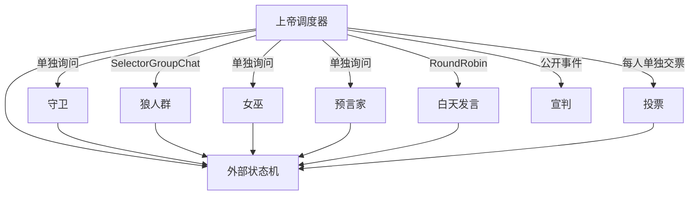

# 狼人杀

用微软 AutoGen 0.7 做的电子狼人杀。夜晚和白天不是同一间聊天室。

上帝是调度器，不坐进玩家群里发言。胜负、刀口、解药、放逐都由外部状态机结算。模型只负责扮演，并在需要行动时给出最后一行 `[ACTION]`。

## 频道怎么拆

AutoGen 的 GroupChat 会把同一条消息广播给**这份参与者名单里的每一个人**，并写进他们的模型上下文。名单外的人收不到。一个人的夜晚行动不再套 GroupChat，直接调用那一个座位。

| 阶段 | 怎么跑 | 谁在里面 |
| --- | --- | --- |
| 守卫、女巫、预言家、猎人、遗言 | 单独询问一次 | 只有对应玩家 |
| 狼人密谈 | `SelectorGroupChat`，可以 `[ACTION] pass`；只剩一名狼人时单独询问 | 存活狼人 |
| 白天发言 | `RoundRobinGroupChat` | 当时还活着的人 |
| 投票 | 每人单独交 `[ACTION] vote=pX`，看不到别人的票 | 一名存活玩家 |
| 宣判 | 状态机直接广播，不开聊天室 | 只写给还活着的人 |

狼人密谈在全体给出同一个刀口，或全体 pass，或到达最大轮数时结束。先发言的狼人**不会**在同一夜里听到后面的人。上一夜的完整狼队记录，只在**下一夜开场**写进狼人群任务。中途插入系统消息会被多数聊天模型拒绝，所以这条记录放在开场任务里，来源仍是上帝。

死者移出公聊。遗言是单独频道。投票任务里会带上当天的发言记录，所以换一份调用也不会变成瞎投。

跨频道时，状态机只放出公开事实：谁出局、明牌身份、还剩哪些座位。刀口、守护、药水和查验原文留在裁判笔记和对应私聊里。

猎人能不能开枪由状态机判断。不能开枪时，私聊里只有「你不能开枪」，猎人回复 `[ACTION] pass`，任务里不写原因。开枪结果再作为公开事件广播。



控制台会把每个频道都打印出来，因为你在看裁判视角。这不等于玩家看见了。核对方法是看 `logs/latest.json`：`sessions` 里有 `kind`（`solo` / `group` / `broadcast`），`wolf` 的 `participants` 只有狼人，`public` 的正文里没有 `（狼队密谈）`、`刀口:`、`查验结果:`。同一次记录里还有每次状态转移、每次 `[ACTION]` 的原文和解析结果，以及每次模型调用的 prompt、response、token 和耗时。

## 规则

默认写在 `config.yaml`，开局读取。没有唯一正确答案的条目必须显式声明：

```yaml
rules:
  guard_witch_same_target: die    # die 同守同救仍然死亡，live 则存活
  witch_self_save: true
  witch_double_potion: false
  hunter_poison_shoot: false
  vote_tie: no_exile              # no_exile 无人出局，pk 只在平票座位里再投一次
  win_condition: slaughter_town   # slaughter_side 为屠边
  action_fallback: pass           # 解析失败时 pass，或 random（沿用本局种子）
```

三套牌的胜负口径跟这份配置走，不另起一套：

- `classic6`：2 狼、预言家、女巫、守卫、村民
- `classic9`：3 狼、预言家、女巫、守卫、猎人、2 村民
- `classic12`：4 狼、预言家、女巫、守卫、猎人、4 村民

`slaughter_town`（默认，屠城）：场上狼人数量大于等于好人时狼人获胜；狼人全部出局则好人获胜。`classic12` 要打到 4 对 4。`slaughter_side`（屠边）：神职（预言家、女巫、守卫、猎人）或村民被杀光，狼人获胜。

夜晚顺序是守卫、狼人、女巫、预言家，然后结算，再处理猎人。

- 守卫不能连续两夜守同一个人。非法守护由状态机改成空守。守护挡得住狼刀，挡不住毒药。
- 女巫解药、毒药各一瓶。同一夜既救又毒时，毒药作废且不消耗，除非 `witch_double_potion` 打开。空刀不消耗解药。
- 猎人被狼刀或放逐可以开枪，被毒杀默认不能。开枪之后才判定胜负。
- 放逐取唯一最高票。出局身份公开，死因不公开。
- 白天发言必须点名一个座位并说明理由。不要只报座位号，也不要说先听发言、暂不站边。狼人自己的提示里只给手段：可以悍跳预言家、守卫或女巫，也可以深藏；可以质疑，也可以不质疑。看这一天谁已经跳了、同伴有没有抢身份、自己有没有被盯上。不按座位号派身份。夜里可以刀同伴，自刀做不做由当夜判断。这些都不写进全体任务。
- 每一轮公聊发言都会做泄漏检查：私密标记、狼队口令、点名同伴。命中记在裁判记录和日志的 `leaks` 里，原文仍留在公聊。遗言里命中则整句不进公聊。
- 发言里如果跳出角色（提到人工智能、系统提示，或「根据规则我」），会改写成短句，并尽量保留最后一条 `[ACTION]`。

`[ACTION]` 取最后一个匹配，并检查目标是否存在、是否存活、是否本阶段合法。失败时按 `action_fallback` 降级，不让整局崩掉。

## 运行

```powershell
uv venv --python 3.12 .venv
uv pip install --python .venv\Scripts\python.exe -r requirements.txt
.\.venv\Scripts\python.exe -m werewolf --mock
```

`--mock` 不访问网络。脚本玩家会在狼人群里留下口令 `（狼队密谈）`，用来核对这句话没有进入公聊。

牌桌页面：

```powershell
.\.venv\Scripts\python.exe -m werewolf --web
```

浏览器打开 `http://127.0.0.1:8765`。先开一桌，把页面上的地址发给别人。每人点一个空位，自己选厂家，填自己的密钥。坐满后，开桌的人按「开斗」。同一家模型可以来多个人。密钥输入框不显示明文，只留在这桌的内存里，不写进浏览器，也不落盘，别人的页面上看不到。部署到服务器时加上 `--host 0.0.0.0`，发出去的链接会用访客自己打开的那个域名。勾选演练房可以不填密钥。

玩家模型按厂家发。`config.yaml` 的 `vendors` 排好顺序：6 人用前 6 家，9 人用前 9 家，12 人用全部 12 家。开局用 `--seed` 把这几家洗到座位上，同一厂家不会分给两个人。换种子，身份和模型都会变；不换种子，两次开局一样。

模型名字只出现在裁判记录和 `logs/latest.json` 的 `seat_models` 里，不写进玩家的系统提示。命令行跑真实模型时，密钥放在环境变量，变量名见 `.env.example`。

```powershell
.\.venv\Scripts\python.exe -m werewolf --preset classic12 --seed 7
```

常用参数：`--config`、`--talk-rounds`、`--wolf-rounds`、`--log`。记录默认写到 `logs/latest.json`。`--seed` 同时固定身份洗牌、厂家洗牌，以及随机降级。

测试：

```powershell
.\.venv\Scripts\python.exe -m unittest discover -s tests -v
```
